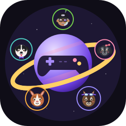

<p align="center">
  
</p>

<h1 align="center">Satronho Emulation</h1>
<p align="center"><b>por Ridds</b> · La casa de los emuladores de la familia Satronho</p>

---

Un solo lugar para tus consolas, con una imagen cuidada, controles que responden al instante, un medidor en vivo y configuraciones sugeridas para tu equipo. Te acompañan los guías de la familia Satronho: **Samy**, **Troya**, **Ñoño**, **Juana** y **MechaRidds**.

Cada emulador de la familia tiene su nombre Satronho:

| Emulador | Para juegos de | Estado |
|---|---|---|
| **Satronho Octa** | NES / Famicom | Disponible |
| **Satronho Bolsillo** | Game Boy y Game Boy Color | Disponible |
| **Satronho Bolsillo Plus** | Game Boy Advance | Disponible |
| **Satronho Mega** | Genesis / Mega Drive | Disponible |
| **Satronho Hexa** | Super Nintendo / Super Famicom | Disponible |
| **Satronho CD** | PlayStation | Disponible |
| **Satronho 64** | Nintendo 64 | Disponible |
| **Satronho Dual** | Nintendo DS (3DS más adelante) | Disponible |
| **Satronho Anillo** | Sega Saturn (con tu BIOS) | Disponible |
| Satronho Cubo, Sueño, CD2, Portátil | GameCube/Wii, Dreamcast, PlayStation 2, PSP | Más adelante |
| [Satronho NX](https://github.com/Riddsc/satronho-nx) | Switch | App aparte |

## Lo que trae

- **Biblioteca** con portadas de cartucho dibujadas para cada juego, búsqueda, favoritos, orden por recientes o más jugados, tiempo de juego y «Seguir jugando».
- **Imagen**: filtro «Nítido suave» (píxeles cuadrados y sin temblores a cualquier tamaño), escala entera, líneas de barrido, pantalla CRT con máscara de fósforo y viñeta, rejilla LCD para las portátiles, fondo ambiente con los colores del juego y pantalla completa a 60 Hz en monitores de 120/144 Hz.
- **Imagen propia por consola**: cada consola puede tener su efecto, filtro y tamaño (menú del juego » Ajustes rápidos).
- **Controles**: el control de cada consola dibujado con sus botones iluminándose en vivo, perfiles por consola, Jugador 1 y 2 (cada uno recuerda su mando aunque otro se desconecte), asignación automática o uno por uno, atajos asignables con aviso si chocan, vibración y nombres de botones según tu mando (Xbox, PlayStation o Switch). Además: adelanto de cuadros (NES), rebobinar, avance rápido (apagado de fábrica) y turbo.
- **Estados**: 8 ranuras con miniatura y fecha, más una ranura automática al salir: «Continuar» sigue justo donde quedaste. «Deshacer la carga» por si eliges la ranura equivocada.
- **Partidas de batería**: se guardan solas, cada consola en su carpeta, con una copia de seguridad (.srm.bak).
- **Medidor Satronho** (compacto o detallado): FPS, velocidad, tiempo del núcleo, gráfica de cuadros, tirones, CPU, RAM y sonido.
- **Configuración sugerida**: Ñoño revisa tu procesador, memoria, tarjeta gráfica y pantalla, y con «Aplícalo por mí» deja todo listo.
- **Sonido** con control dinámico de velocidad, para que no se corte ni se atrase.
- **Juegos en disco**: lista de discos en el menú y cambio de disco como en la consola.
- **Barra de menús en el juego** (Juego, Imagen, Sonido, Controles, Herramientas…) y barra de estado, como en Satronho NX. En pantalla completa aparece con Esc.
- **Herramientas**: prueba de mandos en vivo, Memory Cards de PS1, carátulas y carpetas.
- **Vista** de la biblioteca en cuadrícula, carrusel o lista, con tamaño de carátulas a elección.
- **Juegos en .zip y .7z**: se abren directo, sin descomprimir a mano; si traen varios juegos, eliges cuál.
- **Discos a .chd** (opcional): convierte tus .cue/.bin a .chd en Ajustes » Biblioteca para que ocupen menos.
- **Android** con control en pantalla para cada consola, que puedes mover, agrandar y hacer transparente.
- **Actualizaciones** desde la app: Juana avisa cuando sale una build nueva y la instala con un clic (comprobando que la descarga llegó completa).

## Descargar

Las builds están en [Releases](https://github.com/Riddsc/Satronho-Emulation/releases):

- **Windows (x64)**: descomprime la carpeta y abre `satronho-emulation.exe`.
- **Android (8 o más nuevo, 64 bits)**: instala `SatronhoEmulation-build-N-android-arm64.apk`. La primera vez la app te pide permiso para ver tus carpetas de juegos.

¿Todo en una sola carpeta (por ejemplo, en una memoria USB)? Crea un archivo vacío llamado `portable.txt` junto al programa.

Satronho Emulation **no incluye juegos**. Usa copias de los cartuchos que tienes.

## Atajos

| Tecla | Mando | Acción |
|---|---|---|
| Esc | Guía o Select+Start | Menú del juego |
| F5 / F9 | | Guardar / cargar estado |
| F6 / F7 | | Cambiar de ranura |
| Tab (mantener) | (sin asignar) | Avance rápido · apagado de fábrica, se enciende en Ajustes » Rendimiento |
| Retroceso (mantener) | Gatillo izquierdo | Rebobinar |
| P | | Pausa |
| F4 | | Reiniciar |
| F3 | | Medidor |
| F12 | | Captura |
| F11 o Alt+Enter | | Pantalla completa |
| F2 | Clic del stick derecho | Cambiar pantallas (Satronho Dual) |

Todos se cambian en Controles » Atajos. Un botón del mando que use el juego no dispara su atajo.

## Compilar

Las builds oficiales las hace GitHub Actions desde Linux con [llvm-mingw](https://github.com/mstorsjo/llvm-mingw) (ver `.github/workflows/build.yml`). En local:

```bash
export LLVM_MINGW=/ruta/a/llvm-mingw
for s in scripts/build-core-*.sh; do "$s" build/cores; done   # los 8 núcleos
cmake -S . -B build -G Ninja -DCMAKE_TOOLCHAIN_FILE=cmake/llvm-mingw.cmake
cmake --build build
```

También compila de forma nativa en Linux (`cmake -S . -B build && cmake --build build`), útil para probar. Detalles técnicos y cómo continuar el proyecto: [`SATRONHO.md`](SATRONHO.md) y [`CONTINUAR.md`](CONTINUAR.md).

## Créditos

Logo, guías, interfaz y diseño: **Ridds**.

Satronho Emulation es software libre bajo la licencia **GPL 3.0 o posterior** (ver `LICENSE`) y está construido sobre el trabajo de estos proyectos, a los que agradecemos:

| Proyecto | Para qué | Licencia |
|---|---|---|
| [Nestopia UE](https://github.com/libretro/nestopia) | Núcleo de Satronho Octa | GPL 2.0 o posterior |
| [mGBA](https://github.com/mgba-emu/mgba) | Núcleo de Satronho Bolsillo y Bolsillo Plus | MPL 2.0 |
| [BlastEm](https://github.com/libretro/blastem) | Núcleo de Satronho Mega | GPL 3.0 |
| [bsnes](https://github.com/libretro/bsnes) | Núcleo de Satronho Hexa | GPL 3.0 |
| [Beetle PSX HW](https://github.com/libretro/beetle-psx-libretro) | Núcleo de Satronho CD, con OpenGL y Vulkan (incluye OpenBIOS, MIT) | GPL 2.0 |
| [Mupen64Plus-Next](https://github.com/libretro/mupen64plus-libretro-nx) | Núcleo de Satronho 64 (con GLideN64, ParaLLEl-RDP y Angrylion) | GPL 2.0 |
| [melonDS DS](https://github.com/JesseTG/melonds-ds) | Núcleo de Satronho Dual (incluye FreeBIOS) | GPL 3.0 |
| [Beetle Saturn](https://github.com/libretro/beetle-saturn-libretro) | Núcleo de Satronho Anillo | GPL 2.0 |
| [SDL 3](https://github.com/libsdl-org/SDL) | Ventana, sonido, mandos y dibujo | zlib |
| [Dear ImGui](https://github.com/ocornut/imgui) | Base de la interfaz | MIT |
| [libretro API](https://github.com/libretro/libretro-common) | Conexión con los núcleos (también la de Vulkan) | MIT |
| [Vulkan-Headers](https://github.com/KhronosGroup/Vulkan-Headers) | Definiciones de Vulkan | Apache 2.0 / MIT |
| [libretro-thumbnails](https://github.com/libretro-thumbnails/libretro-thumbnails) | Carátulas de los juegos (se descargan; no vienen incluidas) | Varias (de sus autores) |
| [stb](https://github.com/nothings/stb) | Lectura de PNG y JPG, guardado de PNG | Dominio público / MIT |
| [Poppins](https://github.com/google/fonts/tree/main/ofl/poppins) | Tipografía | SIL OFL 1.1 |
| [JetBrains Mono](https://github.com/JetBrains/JetBrainsMono) | Tipografía de números | SIL OFL 1.1 |

Los textos completos de las licencias están en la carpeta `licencias/`.

Los nombres de las consolas se usan solo para describir con qué juegos funciona cada emulador. NES, Super Nintendo, Game Boy, Nintendo 64, GameCube, Wii, DS y Switch son marcas de Nintendo; Genesis, Mega Drive, Saturn y Dreamcast, de Sega; PlayStation, de Sony. Este proyecto no está afiliado a ninguna de ellas.
